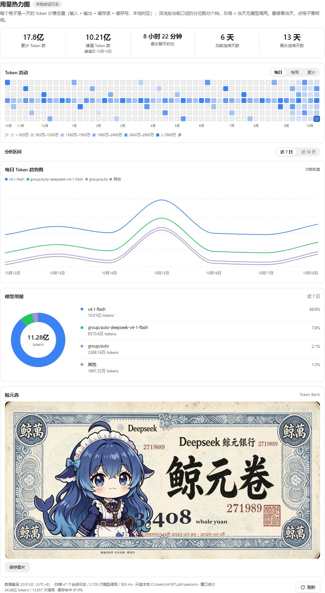
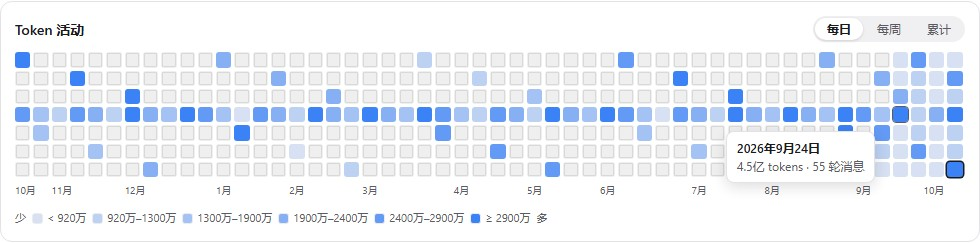
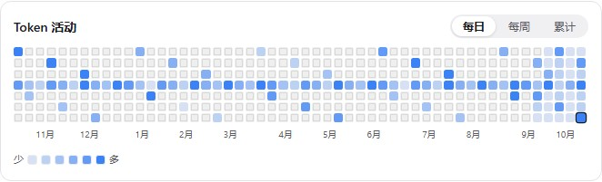

# dsh-token-heatmap

DeepSeek Harness 的「用量热力图」插件：在设置面板里加一整页用量统计 —— 六档深浅的 Token 活动热力图、五项 KPI、每日趋势曲线、模型用量环形图。**只读**扫描本地会话日志，不发任何网络请求，不采集、不上传。







## 功能

- **Token 活动热力图**：列 = 周（周一起），行 = 周一…周日，周数随面板宽度自适应（上限 52 周）；右上 `每日 | 每周 | 累计` 三档口径；六档配色带区间图例；今天那格加 ring；悬停出浮层（`2026年9月24日` / `4.5亿 tokens · 55 轮消息`），点格子下钻到当天明细与分模型表格。
- **KPI 条**：累计 Token 数、峰值 Token 数（副标题峰值日）、最长聊天时长、当前连续天数、最长连续天数。
- **每日 Token 趋势图**：多系列平滑曲线 + 对数纵轴，图例取区间内 top 模型（含「其他」兜底），悬停显示竖线与浮层。
- **模型用量环形图**：中心显示区间总量，右侧列表给出占比与 token 数。
- **鲸元券（Token Bank）**：把区间总量铸成一张真钞风格的票面 —— canvas 在底图上写 `1,000,000,000 token` 面额（Times New Roman 粗体衬线、深藏青）与印章红序列号行，宽窄自适应（数字再长也不压角色、不压印章）；可保存 PNG、可走系统分享。


- **左导航图标改画**：宿主对插件 section 一律回落到齿轮图标，客户端半在面板渲染后就地把那一行换成折线柱图标（不改 `innerHTML`、不动尺寸、可自愈，`MutationObserver` 不自激）。

## 安装

作为 DSH bundle 安装（插件自带 `dsh.bundle.patch`，挂载时自动 insert `token-heatmap` 服务）：

```bash
# 在本仓库根目录
dsh plugin install /path/to/plugin-heatmap
```

或用 `plugin_manager`（`install_bundle` / `remove_bundle`）。安装后：

- **浏览器半**（`lib/client.js`）：刷新 GUI 页面即可。
- **宿主半**（`src/`）：改动后需重新装载 —— `install_bundle` 对已安装的包返回 `already-installed` 且**不刷新文件**，必须先 `remove_bundle` 再 `install_bundle`。

## 配置

`cordis.patch.yml` 里的三个字段，装完后可在 profile 的 bundle 配置里覆盖：

| 字段 | 默认 | 说明 |
| --- | --- | --- |
| `sessionsHome` | `""` | 会话根目录；留空 = `$DSH_HOME/sessions`，再退到 `~/.dsh/sessions` |
| `weeks` | `26` | 热力图默认窗口（周），运行时 clamp 4…104 |
| `ttlMs` | `15000` | 扫描结果内存缓存时长 |

## 数据与口径

数据源：`<sessionsRoot>/<workspace>/<session-id>/session.v4.jsonl.zstd`（多帧 zstd，逐帧解压），并额外并入 `<DSH_HOME>/.archive-trash/` 的归档会话 —— 否则「删除会话」会让历史用量凭空变小。

- **计费总量** = `input + output + cacheRead + cacheWrite`
- **轮消息** = 当天 `type === 'user/message'` 且 `data.source.kind === 'user'` 的事件数（注入的 `time-context` / `team-message` / `skill-catalog` 等不算用户发言）
- **最长聊天时长** = 逐会话取「相邻事件间隔 ≤ 30 分钟」的连续活跃段，取最大段长
- **连续天数 / 峰值** = 按本地日聚合的 `total > 0` 天数与最大值

三档 `mode` 只影响分档口径（`day` / 所在周合计 / 累计），**不会**导致重新解压日志：暖缓存后换 `mode` 必须满足 `stats.reusedFiles === stats.files`、`stats.decompressedFiles === 0`，这条契约由 `test/payload.smoke.mjs` 与 `test/ui.render.test.mjs` 钉住。

首次运行会建一份**追加式账本**（`<DSH_HOME>/token-usage-ledger.v1.json` 一侧），之后每个日志文件只按字节 offset 摄取新增事件，已入账的数字只增不改 —— 日志或归档被删也不会让历史数字变小。

完整接口契约（payload 字段、指标标注、界面清单）见 [CONTRACT.md](./CONTRACT.md)。

## 目录结构

```
plugin-heatmap/
  CONTRACT.md           宿主半 ↔ 浏览器半的接口冻结文档
  package.json          dsh.bundle.patch + dsh.client（platform: web）
  cordis.patch.yml      insert id=token-heatmap（可配 sessionsHome / weeks / ttlMs）
  src/scan.js           纯数据层：多帧 zstd 解压、usage 抽取、轮消息、活跃段、分桶、分位阈值、mode 取值
  src/cordis.js         宿主半：TokenHeatmapService（三层缓存）+ Remote 描述符
  src/ledger.js         追加式账本：按字节 offset 增量摄取，历史只增不改
  lib/client.js         浏览器半：模块工厂 + settings.section 整页 UI（无 JSX、无构建链）
  test/                 冒烟、payload 契约、导航图标、离线 DOM 渲染回归
```

宿主半零依赖：只用 `node:` 内置模块（`node:zlib` 的 zstd 支持，需要 Node ≥ 22.18），不 import 任何 `@deepseek-ai/*` 宿主包 —— 插件被链接在 profile 目录下，import 宿主包会解析出第二副本，Service 原型链跨副本会失效。

## 测试

```bash
node test/smoke.mjs                  # 宿主半冒烟：直接跑本地真日志
node test/payload.smoke.mjs          # CONTRACT 契约断言（三种 mode / allTime / 结构关系）
node test/nav-icon.browser.test.mjs  # 左导航图标改画的真 Chromium 回归
node test/ui.render.test.mjs         # 浏览器半离线 DOM 回归（真 React 18 + 真 lib/client.js）
```

浏览器类测试用 Playwright 的 Chromium，可用环境变量指定路径：`DSHP_PLAYWRIGHT`（playwright 模块）、`DSHP_CHROME`（Chrome 可执行文件）、`DSHP_HARNESS`（离线 React 测试台目录）、`DSHP_SHOTS`（截图输出目录）。

## 说明

- 数据全部留在本机：插件只读会话日志，不联网。
- 热力图配色走 `--dsw-*` 主题令牌；数据色板是显式色值（`--thm-accent` 派生六档），不跟主题品牌色漂移。

## License

MIT
